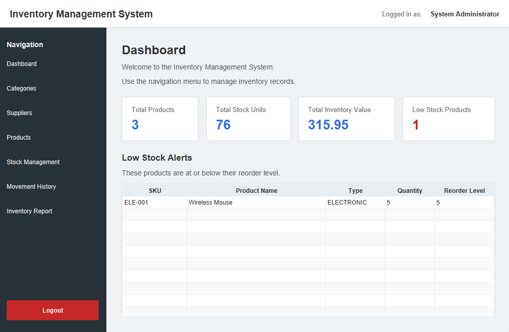
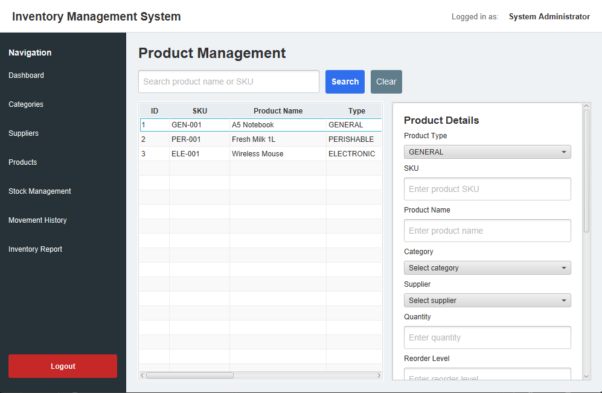
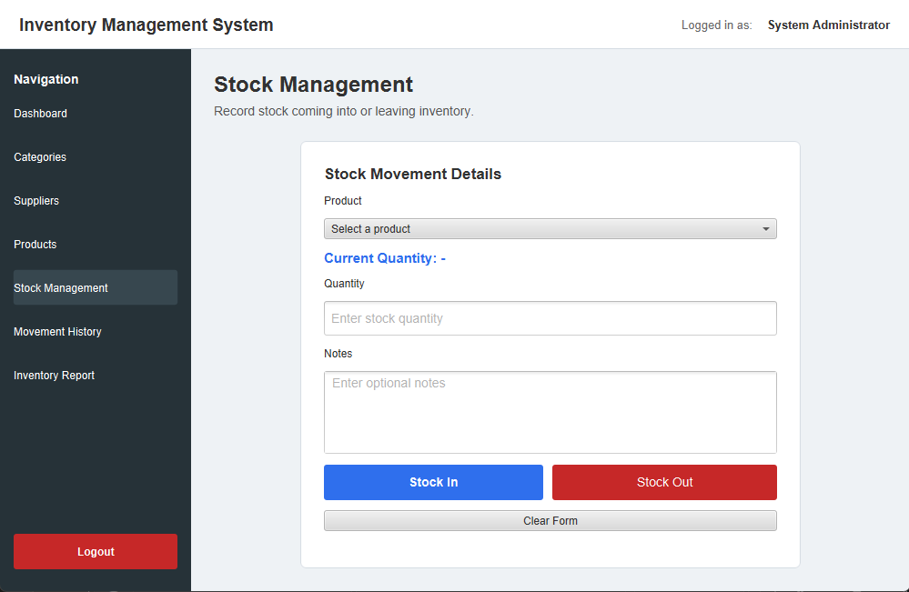
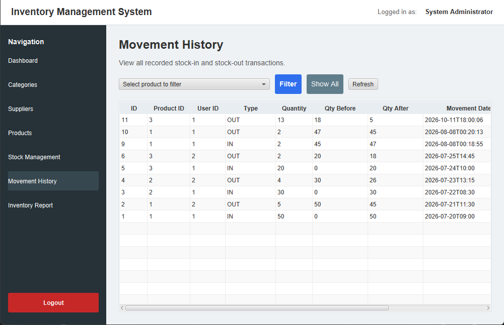
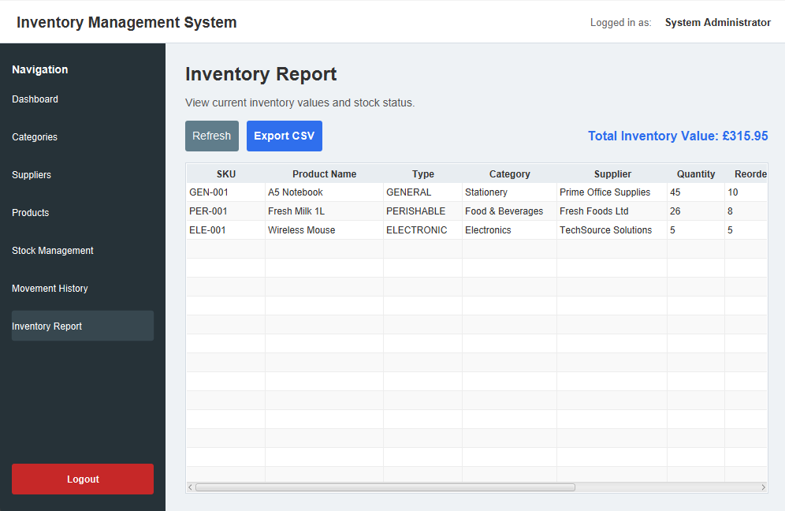

# Inventory Control System

A desktop inventory management application built with **Java, JavaFX, JDBC and SQLite**.
It demonstrates object-oriented design and a layered architecture in a desktop application.

Small businesses often track stock in spreadsheets or on paper, which leads to inaccurate quantities, duplicate records and no history of what changed. This application keeps products, categories, suppliers and every stock movement in one database, and shows low-stock products on the dashboard.

## Features

- **Login / logout** with SHA-256 hashed passwords
- **Dashboard** with total products, total stock units, total inventory value, and a low-stock alert list
- **Products**: add, update, delete, search; three product types (General, Perishable with expiry date, Electronic with warranty months)
- **Categories** and **Suppliers**: add, update, delete, search
- **Stock In / Stock Out** with validation: stock-out cannot exceed available quantity, and the quantity update and movement record are saved in a single database transaction (rolled back on failure)
- **Movement history** with a product filter
- **Inventory report** with CSV export
- Input validation with clear error dialogs (duplicate SKU, invalid email, missing expiry date, and more)

## Screenshots

**Dashboard** – summary cards and low-stock alerts



| Product management | Stock management |
|---|---|
|  |  |

| Movement history | Inventory report |
|---|---|
|  |  |

*(The dashboard and history screenshots were taken after a demo stock-out of the Wireless Mouse, so one product shows as low stock. Older screenshots of every screen are in `documentation/frontend`.)*

## Technology

| Area | Technology |
|---|---|
| Language | Java (JDK 25) |
| GUI | JavaFX 25.0.4, FXML, CSS |
| Database | SQLite (`database/inventory.db`) |
| Data access | JDBC (`sqlite-jdbc 3.53.2.0`) with a hand-written DAO layer |
| Editor | Visual Studio Code with the Java extensions |

## Architecture

The application is split into layers so that each part has one job:

```
FXML screen  ->  Controller  ->  Service  ->  DAO  ->  JDBC  ->  SQLite
(resources/fxml) (src/controller) (src/service) (src/dao)         (database/inventory.db)
```

| Package | Responsibility |
|---|---|
| `src/app` | `MainApp` – starts JavaFX and opens the login screen |
| `src/controller` | Handles button clicks and shows dialogs; never touches SQL |
| `src/service` | Business rules and validation (e.g. no stock-out beyond available quantity) |
| `src/dao` | `CrudDAO<T>` interface and the JDBC implementations that run the SQL |
| `src/model` | Domain classes (`Product`, `StockMovement`, `Alert`, …) |
| `src/exception` | Custom exceptions (`ValidationException`, `InsufficientStockException`, …) |
| `src/util` | `SceneManager`, `SessionManager`, `DialogUtil`, `ValidationUtil`, `PasswordUtil`, `CsvInventoryExporter`, `DatabaseConnection` |
| `src/test` | Backend test programs (run with a `main` method) |

## OOP concepts demonstrated

- **Encapsulation** – private fields with getters and setters in every model class
- **Inheritance** – `BaseEntity` is the parent of the model classes; `GeneralProduct`, `PerishableProduct` and `ElectronicProduct` extend `Product`; `StockIn` and `StockOut` extend `StockMovement`
- **Abstraction** – `Product`, `StockMovement` and `Alert` are abstract classes
- **Polymorphism** – each product type overrides `getProductType()` and `getSpecialInformation()`; the DAO creates the correct subclass from the `product_type` column
- **Interfaces** – the generic `CrudDAO<T>` interface is implemented by the entity DAOs

## Database

SQLite with five tables: `users`, `categories`, `suppliers`, `products`, `stock_movements`.
Foreign keys are enabled with `PRAGMA foreign_keys = ON`. See `database/schema.sql`, `database/sample_data.sql` and `database/database_notes.txt`.

## Getting started

### Prerequisites

- JDK 25
- JavaFX SDK **25.0.4** – download it from <https://gluonhq.com/products/javafx/> and extract it so that the folder `lib/javafx-sdk-25.0.4/lib` exists
- Visual Studio Code with the *Extension Pack for Java* (recommended)

The SQLite JDBC driver (`lib/sqlite-jdbc-3.53.2.0.jar`) is included in the repository.

### Run

1. Open the project folder (the one containing `src`, `lib`, `resources` and `database`) in VS Code and let the Java extension build the project into `bin`.
2. In the VS Code terminal, from the project folder, run:

```
java --module-path "lib/javafx-sdk-25.0.4/lib" --add-modules javafx.controls,javafx.fxml -cp "bin;resources;lib/sqlite-jdbc-3.53.2.0.jar" app.MainApp
```

(On macOS/Linux use `:` instead of `;` in the classpath, and the JavaFX SDK for your operating system.)

### Demo logins

These accounts come from `database/sample_data.sql` and are for demonstration only.

| Username | Password |
|---|---|
| `admin` | `admin123` |
| `staff` | `staff123` |

### Reset the database

Delete `database/inventory.db`, then run `database/schema.sql` followed by `database/sample_data.sql` with any SQLite tool.

### Tests

The classes in `src/test` are small test programs, each with its own `main` method (for example `BackendSmokeTest`, `StockTransactionTest`, `CsvExportTest`). Some of them write to the database, so run them against a copy of `inventory.db`.

In addition, 28 manual test cases were run across all screens. 26 passed; the two failures were a product that could not be deleted when it had movement history, and missing dashboard statistics. The dashboard statistics and low-stock alerts have since been added; deleting a product that has movement history is still not handled.

## Known limitations

- A product that has stock-movement history cannot be deleted, and the error message does not explain why
- Login and logout do not show a confirmation dialog
- Passwords use unsalted SHA-256 – fine for a demo, not suitable for production
- One user role only (no admin/staff permissions); local SQLite database, single user at a time
- No automated unit-test framework (JUnit); tests are plain `main` programs plus manual test cases

## Future improvements

- Salted password hashing (e.g. bcrypt) and role-based access
- Soft-delete or archive for products with history
- Charts and reorder suggestions in the reports
- Automated regression tests (JUnit)

## Contributions

Built as a team project. Frontend work (JavaFX, FXML, controllers, navigation, CSS and integration with the backend) by Jawad Khaled, who also later added the dashboard summary cards and the low-stock alert list.
